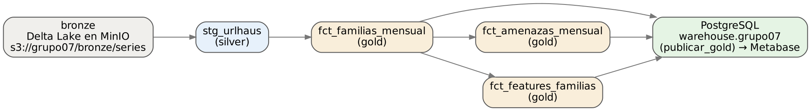

# Governance del dataset — Amenazas URLhaus (grupo07)

Ingeniería de Datos — LCD · UCA Rosario · 2026 · grupo07

## 1. Identificación

| | |
| --- | --- |
| **Nombre** | Amenazas URLhaus mensuales |
| **Qué contiene** | Cuántas URLs nuevas que distribuyen malware se reportaron cada mes a URLhaus, separadas por familia de malware (Mozi, mirai, LuaJIT-loader, ...) y por el tipo de archivo que descargan (ejecutable de Linux, de Windows, comprimido, ...). Incluye además variables derivadas para seguir la tendencia de cada familia. |
| **Para qué existe** | Para responder qué familias de malware están más activas, cómo cambian de un mes a otro y en qué formato se distribuyen, y así priorizar reglas de bloqueo y detección. |
| **Responsable** | **Francisco Lauria** (grupo07). Si un número está mal, abrir un *issue* en el repositorio o escribirle directamente. |
| **Dónde está** | PostgreSQL, base `warehouse`, esquema `grupo07`: `fct_familias_mensual`, `fct_amenazas_mensual` y `fct_features_familias`. Se consulta en el tablero "Amenazas URLhaus — grupo07" de Metabase. |
| **Actualización** | Todos los días a las 00:00 (hora de Córdoba), con el DAG `pipeline_grupo07` de Airflow. |

## 2. Origen y linaje

**Origen.** [URLhaus](https://urlhaus.abuse.ch) es un proyecto de abuse.ch (abuse.ch AG, Suiza), que opera en cooperación con Spamhaus. Investigadores y equipos de seguridad de todo el mundo reportan ahí URLs que están distribuyendo malware. Se actualiza en forma continua: del orden de 4.000 URLs nuevas por día. Se accede con una Auth-Key gratuita.

Usamos dos accesos de URLhaus:
- La **API** `/v1/urls/recent/` (las URLs de los últimos 3 días, máximo 1000), para la ingesta incremental de NB02.
- Los **exports CSV** (`recent.csv`, los últimos 30 días, y `full.csv.zip`), para la ingesta diaria del DAG y para reprocesar el pasado.

**Histórico y cobertura.** Hay datos desde junio de 2018, pero **solo están completos desde octubre de 2026**. URLhaus no conserva un histórico completo: su export trae casi todo el último mes y, de los meses anteriores, solo una parte de las URLs. Lo que acumulamos día a día no se pierde, pero lo que el origen ya no publica no se puede recuperar (ver *Huecos* en la sección 5).

**Recorrido de los datos.**

1. **Bronze** (Delta Lake en MinIO, `s3://grupo07/bronze/series`): una fila por URL, tal como la publica URLhaus. Nunca se borra: cada carga agrega las URLs nuevas y actualiza las que ya estaban (por ejemplo, si pasaron de online a offline).
2. **Silver** (`stg_urlhaus`): una fila por URL sin duplicados, con fechas en UTC, y con la familia de malware y el tipo de archivo deducidos de las etiquetas, descartando las que no son una familia (arquitecturas, servicios de hosting, países, IPs, dominios, honeypots, términos genéricos).
3. **Gold** (`fct_familias_mensual`): cuenta las URLs por mes, familia y tipo de archivo. `fct_amenazas_mensual` es su total por mes.
4. **Features** (`fct_features_familias`): por mes y familia, el mes anterior, la variación, el promedio de 3 meses, el acumulado y la participación en el mes, usando siempre solo datos de ese mes o anteriores.
5. **Publicación**: las tres tablas se copian a PostgreSQL en una sola operación (si algo falla, queda la versión anterior completa) y de ahí las lee Metabase.

**Diagrama de linaje** generado por dbt (`dbt docs generate`), no dibujado a mano:

## 3. Diccionario de datos

### `fct_familias_mensual` — URLs nuevas por mes, familia y tipo de archivo

| Columna | Tipo | Significado | Ejemplo |
| --- | --- | --- | --- |
| `fecha` | date | Primer día del mes en que URLhaus registró las URLs | `2026-10-01` |
| `anio` | integer | Año de ese mes | `2026` |
| `mes` | integer | Número de mes, 1 a 12 | `10` |
| `tipo_amenaza` | text | Clasificación de URLhaus. En la práctica es siempre `malware_download` (la URL descarga malware); URLhaus no documenta qué otros valores puede tomar | `malware_download` |
| `familia_malware` | text | Familia de malware que distribuyen las URLs. Sale de las etiquetas que carga quien reporta, así que es aproximada. `sin_familia` si ninguna etiqueta la identifica | `LuaJIT-loader` |
| `tipo_archivo` | text | Formato del archivo que se descarga: `elf` (ejecutable de Linux, típico de dispositivos IoT y routers), `exe` (Windows), `zip`, `sh` (script de Linux), etc. `desconocido` si no hay etiqueta de tipo de archivo | `zip` |
| `cantidad_amenazas` | bigint | URLs maliciosas distintas registradas ese mes con esa familia y ese tipo de archivo. Cada URL cuenta una sola vez | `13755` |
| `actualizado_en` | timestamptz | Cuándo el pipeline publicó la fila | `2026-11-18 20:12:56+00` |

### `fct_amenazas_mensual` — URLs nuevas por mes

Las mismas `anio`, `mes`, `tipo_amenaza`, `cantidad_amenazas` y `actualizado_en`, sumadas por mes. Coincide siempre con la suma de `fct_familias_mensual` (se calcula a partir de ella).

### `fct_features_familias` — Tendencia de cada familia

Una fila por mes y familia, desde el primer mes en que aparece la familia. Los meses en que la familia no tuvo URLs aparecen con 0.

| Columna | Tipo | Significado | Ejemplo |
| --- | --- | --- | --- |
| `fecha`, `anio`, `mes` | date, integer | El mes, como arriba | `2026-10-01` |
| `familia_malware` | text | La familia | `SalatStealer` |
| `cantidad_amenazas` | bigint | URLs nuevas de la familia en el mes | `7820` |
| `cantidad_mes_anterior` | bigint | URLs de la familia en el mes calendario anterior (0 si no tuvo o si es su primer mes) | `2` |
| `variacion_mensual_pct` | numeric | Cambio % contra el mes anterior. Vacío cuando el mes anterior tuvo 0 URLs: no se puede calcular un porcentaje sobre 0 | `390900.00` |
| `promedio_movil_3m` | numeric | Promedio de URLs por mes entre este mes y los dos anteriores (menos meses si la familia es más nueva) | `2608.67` |
| `acumulado` | bigint | Total de URLs de la familia desde su primera aparición hasta este mes | `7840` |
| `pct_del_mes` | numeric | Qué porcentaje de todas las URLs nuevas del mes son de esta familia (0 en meses sin ninguna URL) | `17.46` |
| `mes_completo` | boolean | Falso solo para el último mes, que todavía está en curso: sus valores van a cambiar | `true` |

Ningún valor de una fila usa información de meses posteriores (lo verifica un test que los recalcula desde cero).

**Campos que no terminamos de entender:**
- `tipo_amenaza`: URLhaus no documenta qué otros valores existen además de `malware_download`. Lo publicamos tal cual.
- El estado de una URL (`online`, `offline`, `unknown`, solo en silver): no está documentado cada cuánto URLhaus lo revisa. Lo interpretamos como "el último estado que vio URLhaus".

## 4. Clasificación de sensibilidad

Tres niveles: **Público** (ya es público en el origen), **Interno** (no es secreto, pero no se publica fuera del equipo), **Sensible** (identifica o describe a una persona).

| Campo | Dónde está | Nivel | Por qué |
| --- | --- | --- | --- |
| Todas las columnas de las tres tablas publicadas | gold, PostgreSQL, Metabase | **Público** | Son conteos agregados por mes, familia y tipo de archivo. Ninguna fila corresponde a una URL, a un sitio ni a una persona. |
| `id_amenaza`, `fecha_agregado`, `tipo_amenaza`, `estado`, `familia_malware`, `tipo_archivo`, `etiquetas` | bronze y silver | **Público** | URLhaus los muestra en su sitio para cada URL. |
| `url_maliciosa` | bronze y silver | **Interno** | Es pública en URLhaus, pero apunta a malware que puede seguir activo. Además, muchas son sitios legítimos que fueron hackeados, y la URL identifica al sitio afectado (y a veces a su dueño). No se publica ni se muestra como enlace. |
| `reportero` | bronze y silver | **Interno, con criterio de sensible** | Es el usuario de URLhaus que reportó la URL: identifica a una persona o a un equipo. Es público en URLhaus, pero no lo necesitamos para la pregunta del dataset, así que no sale de silver (minimización). |

**¿La combinación de campos podría identificar a alguien?** En las tablas publicadas, no: no tienen URL, reportero ni sitio, y el grano más fino es mes × familia × tipo de archivo. El caso límite es una familia con una sola URL en un mes. Ese conteo no dice qué URL es ni quién la reportó, pero cruzándolo con el sitio público de URLhaus se podría encontrar. Lo aceptamos porque la información ya es pública en el origen y no agrega nada sobre una persona.

**Credenciales:** la Auth-Key de URLhaus y las contraseñas de MinIO y PostgreSQL viven en variables de entorno y en `dags/.env`, que no se versiona (el CI falla si aparece un `.env` o una clave en el repositorio). No figuran en ningún notebook ni en los logs de Airflow.

## 5. Calidad y garantías

**Qué se verifica en cada corrida.** Si alguna de estas verificaciones falla, no se publica nada y PostgreSQL conserva la última versión buena.
- No hay URLs duplicadas ni sin identificador. Todas tienen fecha, familia y tipo de archivo (aunque sean `sin_familia` o `desconocido`).
- Las fechas están entre 2018 (inicio de URLhaus) y hoy. El pipeline trabaja en UTC.
- Ninguna "familia" es en realidad una arquitectura, un tipo de archivo, un servicio de hosting, un país, una IP, un dominio o un término genérico.
- Silver, las dos gold y los features suman exactamente la misma cantidad de URLs.
- Ningún feature usa meses posteriores. Las participaciones están entre 0 % y 100 %, y no hay mes y familia repetidos.
- En PostgreSQL, claves primarias y meses entre 1 y 12. Además, las tres tablas tienen que sumar lo mismo para que la publicación se confirme.

**Frescura.** Se actualiza una vez por día, a las 00:00 de Córdoba (03:00 UTC), con las URLs del día anterior. Una URL reportada hoy aparece mañana. `actualizado_en` dice cuándo fue la última publicación.

**Huecos conocidos.**
- **Antes de octubre de 2026 el histórico está incompleto.** URLhaus registra unas 4.000 URLs por día, más de 100.000 por mes. Los meses de 2018 a 2025 tienen entre unas pocas y unos cientos, y los de junio a septiembre de 2026, entre 4.600 y 15.700. Son las URLs que el origen todavía conserva, más las que fuimos acumulando. **El salto de septiembre a octubre de 2026 es de cobertura, no de amenazas.**
- **El mes en curso está incompleto** (`mes_completo = false`).
- **18.362 URLs, recuperadas el 18/11/2026 después de un reproceso que las había borrado** (ver `INCIDENTE_2026-11-18_backfill.md`), no tienen la fecha en que se las vio activas por última vez. Ese dato está solo en bronze y no se usa en gold.
- Algunos meses viejos no tienen ninguna URL (por ejemplo, 2019-09 o 2021-02).

**Lo que este dataset no permite responder.**
- **El volumen real de amenazas antes de octubre de 2026,** ni tendencias de largo plazo: la cobertura cambia.
- **Cuándo empezó un ataque:** la fecha es la del reporte, no la del ataque.
- **El malware que nadie reportó a URLhaus.** El dataset refleja lo que reporta su comunidad, y algunos reporteros cargan miles de URLs en pocos días: un pico puede ser un reportero muy activo y no una campaña nueva.
- **A quién atacan:** no hay datos de víctimas, de países afectados ni de sectores.
- **Rankings exactos de familias:** la familia es aproximada, porque depende de las etiquetas que pone cada reportero. Según el mes, entre el 10 % y un tercio de las URLs no tiene ninguna familia identificable (`sin_familia`).

## 6. Licencia y uso

**Licencia del origen.** Los [Términos de Uso de abuse.ch](https://abuse.ch/terms-of-use/) (vigentes desde el 4/11/2025, última actualización el 21/10/2026) establecen:
- URLhaus es de acceso gratuito para usuarios autenticados y **con fines no comerciales**, con límites de uso.
- El uso comercial puede requerir una suscripción paga, gestionada por Spamhaus.
- No se pueden hacer obras derivadas de las plataformas ni usar los datos para entrenar IA sin consentimiento.
- **URLhaus no tiene licencia CC0.** CC0 aplica a otros proyectos de abuse.ch (Feodo Tracker, SSL Blacklist, YARAify).
- abuse.ch puede restringir el acceso si no se respetan estas condiciones.

**Qué se puede hacer con este dataset.**
- Usarlo con fines académicos y no comerciales, citando a URLhaus (abuse.ch) como fuente.

**Qué no se puede hacer.**
- Usarlo con fines comerciales.
- Redistribuirlo como producto.
- Usarlo para entrenar modelos de IA sin autorización de abuse.ch y Spamhaus.

**¿Nuestros datos derivados tienen la misma licencia que el origen?** No lo tenemos resuelto. Las tablas publicadas son conteos agregados, no copias de los registros, y podría argumentarse que son un trabajo nuevo. Pero los términos prohíben las "obras derivadas" de las plataformas sin aclarar si un agregado estadístico cuenta como tal. Por eso los tratamos con las mismas restricciones que el origen: uso académico, sin fines comerciales y citando la fuente.

**Código del pipeline:** desarrollado por grupo07 para la materia Ingeniería de Datos (LCD, UCA Rosario, 2026), con fines académicos.
