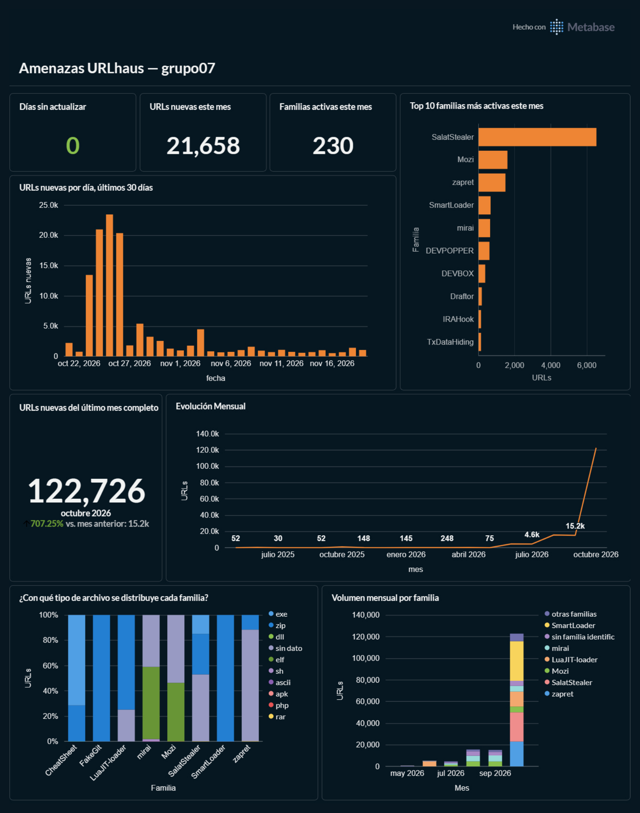

# Tablero "Amenazas URLhaus — grupo07"

En **https://metabase.nexoacademia.org**, base `warehouse`, esquema `grupo07`. El tablero no se versiona en Metabase: este archivo y la captura son lo que viaja con el repo, para poder rehacerlo igual en la defensa.



*Captura del 19/11/2026, con el indicador de días sin actualizar.*

## Cómo leer los números de octubre de 2026

El indicador de URLs nuevas marca +707 % contra septiembre y el gráfico de evolución sube de golpe. **Es un pico real de reportes:** octubre tuvo casi 4.000 URLs por día contra unas 500 en agosto y septiembre, y noviembre vuelve a unas 1.100. Coincide con un solo reportero, `wristhulk`, que desde el 29/09/2026 cargó 96.956 URLs (el 51 % del dataset). En el mismo período aparecen en masa las familias que muestra el gráfico 3 (SmartLoader, SalatStealer, zapret, LuaJIT-loader). Con estos datos no se puede separar cuánto es más malware y cuánto es más actividad de reporte. Por eso el gráfico de familias que sumaron y perdieron URLs muestra casi solo subas.

Lo que sí es cobertura: antes de agosto de 2026 los meses tienen pocas URLs porque el export de URLhaus ya no las conserva (ver `INCIDENTE_2026-11-18_backfill.md`). El gráfico de evolución sirve para comparar los meses recientes, no para medir tendencias de largo plazo.

## Gráficos

Todos se arman con *Nuevo → Consulta SQL*, eligiendo la base **warehouse** arriba a la izquierda (no "Sample Database"). El título de cada gráfico es la pregunta que responde.

**0 · ¿Está al día el tablero?** — *Número* (Días sin actualizar). Cuenta los días desde la última publicación exitosa del DAG. Lo normal es 0, porque el DAG publica todas las noches. Si muestra 1 o más, el tablero tiene datos viejos: el control de volumen frenó la publicación o el DAG no corrió. El motivo está en el log de `publicar_gold` o en `grupo07.estado_publicacion` (consulta de abajo). Conviene ponerle formato condicional: verde en 0, rojo desde 1.
```sql
select current_date - max(publicado_en at time zone 'America/Argentina/Cordoba')::date as dias_sin_actualizar
from grupo07.estado_publicacion
where resultado = 'publicada'
```
Para ver qué pasó (*Nuevo → Consulta SQL*, no va en el tablero):
```sql
select publicado_en, resultado, detalle, urls_publicadas
from grupo07.estado_publicacion
order by publicado_en desc
limit 10
```

**1 · ¿Cuántas URLs maliciosas nuevas se registraron el último mes completo, y cómo viene contra el anterior?** — visualización *Tendencia* (número grande con la variación)
```sql
select fecha as mes, sum(cantidad_amenazas) as urls_nuevas
from grupo07.fct_features_familias
where mes_completo
group by 1 order by 1
```

**1b · ¿Cuántas familias distintas estuvieron activas el último mes completo?** — *Tendencia*, al lado del 1. Mide la diversidad de la amenaza: el volumen puede subir por una sola campaña grande o por muchas familias a la vez.
```sql
select fecha as mes,
       count(*) filter (where cantidad_amenazas > 0 and familia_malware <> 'sin_familia') as familias_activas
from grupo07.fct_features_familias
where mes_completo
group by 1
order by 1
```

**2 · ¿Cómo evolucionó la cantidad de URLs nuevas por mes en el último año y medio?** — *Línea*, solo meses completos. Ojo al leerla: antes de agosto de 2026 el histórico está incompleto, porque URLhaus ya no publica esas URLs (ver `docs/INCIDENTE_2026-11-18_backfill.md`); el salto de septiembre a octubre es un pico de reportes.
```sql
select fecha as mes, sum(cantidad_amenazas) as urls_nuevas
from grupo07.fct_features_familias
where mes_completo
  and fecha >= (select max(fecha) from grupo07.fct_features_familias) - interval '18 months'
group by 1
order by 1
```

**3 · ¿Qué familias de malware explican el volumen de cada mes?** — *Barras apiladas* (eje X: mes; series: familia). Muestra las campañas: una familia que aparece fuerte un mes y desaparece.
```sql
with ult as (select max(fecha) as f from grupo07.fct_features_familias where mes_completo),
ventana as (
    select ff.* from grupo07.fct_features_familias ff, ult
    where ff.fecha > ult.f - interval '6 months' and ff.fecha <= ult.f
),
top as (
    select familia_malware from ventana where familia_malware <> 'sin_familia'
    group by 1 order by sum(cantidad_amenazas) desc limit 6
)
select v.fecha as mes,
       case when v.familia_malware in (select familia_malware from top) then v.familia_malware
            when v.familia_malware = 'sin_familia' then 'sin familia identificada'
            else 'otras familias' end as familia,
       sum(v.cantidad_amenazas) as urls
from ventana v
group by 1, 2
having sum(v.cantidad_amenazas) > 0
order by 1, 3 desc
```

**4 · ¿Qué familias sumaron y perdieron más URLs respecto del mes anterior?** — *Barras horizontales* apiladas, con "Sumó" en verde y "Perdió" en rojo. Se mide en cantidad de URLs y no en porcentaje: muchas familias llegan por campañas y el mes anterior tienen 0, y sobre 0 no hay porcentaje posible (LuaJIT-loader pasó de 0 a 13.762).
```sql
with ult as (select max(fecha) as f from grupo07.fct_features_familias where mes_completo),
base as (
    select ff.familia_malware as familia,
           ff.cantidad_amenazas - ff.cantidad_mes_anterior as diferencia
    from grupo07.fct_features_familias ff, ult
    where ff.fecha = ult.f and ff.familia_malware <> 'sin_familia'
),
r as (
    select *, row_number() over (order by diferencia desc) as n_sube,
              row_number() over (order by diferencia asc) as n_baja
    from base
)
select familia,
       case when diferencia >= 0 then diferencia end as "Sumó URLs",
       case when diferencia <  0 then diferencia end as "Perdió URLs"
from r
where (n_sube <= 5 and diferencia > 0) or (n_baja <= 5 and diferencia < 0)
order by diferencia desc
```

**5 · ¿Con qué tipo de archivo se distribuye cada familia?** — *Barras apiladas al 100 %* (una barra por familia; las 8 más activas de los últimos 6 meses)
```sql
with desde as (select max(fecha) - interval '6 months' as f from grupo07.fct_familias_mensual),
top as (
    select fm.familia_malware from grupo07.fct_familias_mensual fm, desde
    where fm.familia_malware <> 'sin_familia' and fm.fecha > desde.f
    group by 1 order by sum(fm.cantidad_amenazas) desc limit 8
)
select f.familia_malware as familia,
       case when f.tipo_archivo = 'desconocido' then 'sin dato' else f.tipo_archivo end as tipo_de_archivo,
       sum(f.cantidad_amenazas) as urls
from grupo07.fct_familias_mensual f
join top using (familia_malware), desde
where f.fecha > desde.f
group by 1, 2 order by 1, 3 desc
```

**6 · ¿Cuántas URLs nuevas entraron en lo que va del mes?** — *Número*. Sube con cada corrida del DAG: es lo primero que cambia cuando entra un dato nuevo. El mes en curso está incompleto, así que no se compara con meses cerrados.
```sql
select sum(cantidad_amenazas) as urls_en_lo_que_va_del_mes
from grupo07.fct_amenazas_diarias
where fecha >= (select date_trunc('month', max(fecha))::date from grupo07.fct_amenazas_diarias)
```

**7 · ¿Cuántas URLs nuevas entraron cada día, en los últimos 30 días?** — *Barras* (eje X: `fecha`). Muestra el ritmo diario de reportes y los días con picos, que en los gráficos mensuales no se ven.
```sql
select fecha, cantidad_amenazas as urls_nuevas
from grupo07.fct_amenazas_diarias
where fecha > (select max(fecha) from grupo07.fct_amenazas_diarias) - 30
order by fecha
```

**8 · ¿Qué familias son las más activas en lo que va del mes?** — *Barras horizontales* (Fila). El top 10 del mes en curso, sin `sin_familia`: muestra qué está circulando ahora, antes de que el mes cierre.
```sql
select familia_malware, sum(cantidad_amenazas) as urls
from grupo07.fct_familias_mensual
where fecha = (select max(fecha) from grupo07.fct_familias_mensual)
  and familia_malware <> 'sin_familia'
group by 1
order by 2 desc
limit 10
```

**Armado:** arriba, el 0, el 1, el 1b y el 6 lado a lado; abajo, el 7 a lo ancho y el 8 al lado; al medio, el 2 a lo ancho; abajo, el 3 y el 4 lado a lado, y el 5 a lo ancho.

**Qué decisión se toma con esto:** un equipo de seguridad ve si el volumen sube (1 y 2), qué familias lo explican y si son campañas puntuales o actividad sostenida (3), qué familias ganaron o perdieron más actividad este mes (4), y qué formatos bloquear o inspeccionar para cada una (5: `elf` apunta a dispositivos Linux/IoT; `exe` o `zip`, a usuarios de Windows).

**Para leer bien los datos:** la fecha es cuándo URLhaus *registró* la URL, no cuándo ocurrió el ataque; el mes en curso está incompleto (por eso los gráficos 1 a 5 usan solo meses completos; el 6, el 7 y el 8 muestran lo que va del mes, sin compararlo con meses cerrados); antes de agosto de 2026 el histórico está incompleto porque el origen ya no publica esas URLs; la familia es aproximada, porque sale de los tags que carga cada reportero.
